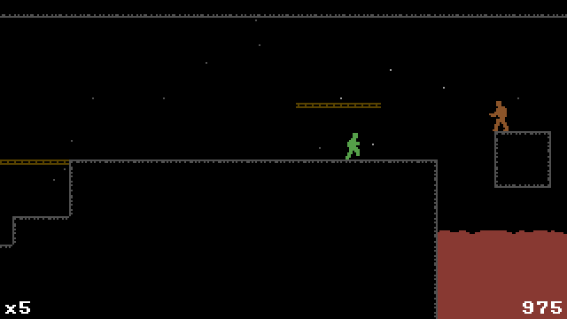

# Smolt

A tiny fantasy-console–style virtual machine.
Write games in a C-like language (`.smolt`), compile to bytecode, and run them on either the native SDL backend or the browser (JavaScript) backend.



**[Play in the browser!](https://2bt.github.io/smolt/)**

| | |
|---|---|
| Display | 320×180, 60 fps, true colour (no palette) |
| Graphics | one blit call: any rectangle of `sprite.png`, with H/V flip |
| Sound | 8 voices: triangle, saw, pulse (width 0–1023), noise; pitch in ⅛ semitones (456 = A4), volume 0–256 |
| Input | d-pad, A, B, menu (keyboard, gamepad, or touch in the browser) |
| CPU | 32-bit words, memory-to-memory instructions, up to 1M instructions per frame |
| Memory | 2²⁴ words of data; code in a separate instruction stream |
| Storage | one save slot per game |
| Language | Smolt: indentation-based, C-flavoured, compiled to assembly |
| Hosts | native (C++/SDL2) and browser (JavaScript), same bytecode |

### Small enough to read in an afternoon

Simplicity is the point, of the spec *and* of the implementation. There's no palette and no built-in font, envelope or music routines; games bring their own, written in Smolt. The complete toolchain is about 3600 lines (not counting blank ones):

| Part | Lines | What you get |
|---|---|---|
| Native host (`src/`, C++/SDL2) | 736 | VM, APU (8 voices, 4 waveforms), window, keyboard and gamepad, saves; plus screenshots, frame recording and WAV capture |
| Web host (`web/index.html`) | 756 | a second VM and APU, plus game menu, touch controls and saves, in one file |
| Assembler (`tools/assemble.py`) | 359 | labels, data, constant expressions; reads its opcodes straight from `vm.cpp` |
| Compiler (`tools/compile.py`) | 1413 | structs, pointers, arrays, block scopes, includes, a peephole optimizer, dead-code and dead-data removal |
| Standard library (`lib/`) | 360 | input, math, strings, text, boxes, and a music and SFX player with ADSR envelopes and its own sequencing language |

Recount with `grep -cv '^\s*$' src/* web/* tools/*.py lib/*`.

Each game is a folder in `games/` with:

* `main.smolt` → entry point (`func tick():` runs every frame)
* `sprite.png` → sprite sheet
* `code` → compiled bytecode (build output, not committed)

Shared code lives in `lib/`. An include path starting with `lib/` always refers to it (e.g. `include "lib/api.smolt"`); any other path is relative to the including file.

* `api.smolt` → host ABI: input, interrupts, constants
* `util.smolt` → input helpers, math, strings, text drawing, boxes
* `audio.smolt` → music and sound-effect players

Game Controls:

* Arrows or WASD → movement
* X → A, Z or C → B, Return → menu
* Esc → quit
* F12 → screenshot (`screenshot-<time>.png`, 320×180)
* R → start/stop recording frames to `recording-<time>/`; `./gif.sh recording-<time>` turns them into a gif
* Gamepad: d-pad / left stick, A or Y → A, B or X → B, Start → menu


## Hello, Smolt

`games/hello/main.smolt`, a complete game:

```smolt
include "lib/api.smolt"
include "lib/util.smolt"
include "lib/audio.smolt"

var x = 152
var y = 82
var score

func tick():
    # move with the d-pad, stay on screen
    if btn(BTN_LEFT):  x -= 2
    if btn(BTN_RIGHT): x += 2
    if btn(BTN_UP):    y -= 2
    if btn(BTN_DOWN):  y += 2
    x = clamp(x, 0, SCREEN_W - 16)
    y = clamp(y, 0, SCREEN_H - 16)

    # A: count and beep
    if btnp(BTN_A):
        score += 1
        audio_play_sfx("@0 d6 W128 P=72,=60,20")

    # draw: the fish is the 16x16 tile at (0, 24) in sprite.png
    sprite(x, y, 16, 16, 0, 24, 0)
    draw_text(8, 8, "Hello, Smolt! Press X.")
    var buf: int[12]
    strnum(buf, score)
    draw_text(8, 20, buf)

    audio_update_sfx()
    input_update()
```

* `tick()` runs 60 times a second; the screen is cleared before each frame.
* `btn()` is "held", `btnp()` is "just pressed" (`input_update()` at the end of `tick()` makes that work).
* `sprite(x, y, w, h, s, t, flip)` copies the `w`×`h` rectangle at (`s`, `t`) of `sprite.png` to the screen.
* `draw_text()` uses the font in the top 256×24 pixels of `sprite.png` (ASCII 32–127, 8×8 each).
* `audio_play_sfx()` plays a sound effect string (`d` decay, `W` pulse width, `P` pulse wave, `=72` pitch, `,` wait a frame, `,20` wait 20 frames).

Run it with `./run.sh hello`. To start your own game, copy `games/hello` to `games/<name>`.


## Build & Run

Dependencies: C++20, SDL2, SDL2_image, CMake, Python 3 (and ffmpeg + gifsicle for `gif.sh`)

```bash
./run.sh                 # Outpost Oberon
./run.sh breakout        # or a path: ./run.sh games/breakout
```

This will:

1. Build the VM (`smolt`), configuring `build/` on the first run
2. Compile `main.smolt` → `main.asm`
3. Assemble `main.asm` → `code`
4. Run the game in the VM

Native host: `build/smolt [--once] [--record out.wav] <game-dir>`. `--once` runs a single frame without a window (for tests and `print` output); `--record` writes the game's audio to a WAV file on exit.

Browser host: `./build.sh` compiles every game and writes `games/index.json` (the game menu); then serve the repo root, e.g. `python3 -m http.server`, and open `/web/`.


## Machine model

* **Word:** signed 32-bit integer. Pointers are word addresses into `mem`.
* **Memory:** flat `mem[0 … 2²⁴)` (words). Code lives in a separate instruction stream (`pc` indexes that, not `mem`).
* **Calls:** `jsr` / `ret` use a host-side return stack. No recursion in Smolt (locals are not re-entrant).
* **Entry:** each frame the host updates `input` and runs from `pc = 0`; the compiler’s entry is `func tick():`.

### Host ABI (low memory)

Pinned in `lib/api.smolt` via `var` / formals `@ addr`:

| Addr | Role |
|------|------|
| `0` | `ret` — host writes interrupt results (e.g. `rand`, `sqrt`) |
| `1` | `input` — button bitfield (`1<<0` up, down, left, right, A, B, `1<<6` menu) |
| `2…` | interrupt argument blocks (disjoint per interrupt) |

Interrupts (`asm "int #N"`):

| N | Name | Args | Notes |
|---|------|------|--------|
| 1 | print | `msg` @ 2 (`int*`) | zero-terminated chars; newline after |
| 2 | sprite | `x y w h s t flip` @ 3–9 | blit from `sprite.png` |
| 3 | sound | `i pitch pw vol wave` @ 10–14 | voice `i` |
| 4 | rand | `lo hi` @ 15–16 | result → `mem[0]` |
| 5 | sqrt | `a` @ 17 | result → `mem[0]` |
| 6 | save | `addr len` @ 18–19 | write `len` words from `addr` to the game's save slot; words written → `mem[0]` |
| 7 | load | `addr len` @ 18–19 | read up to `len` words into `addr`; words read → `mem[0]` (0 = no save) |

Screen is 320×180.

Each game has one save slot: `<game-dir>/save` (raw words) natively, `localStorage` in the browser.


## Assembler & bytecode

`tools/compile.py main.smolt` emits text assembly (`main.asm`) and assembles it into the `code` blob (`--asm-only` skips that step); `tools/assemble.py` can also be run on its own.

**Assembly** (`;` comments):

* `.code` — instructions (default)
* `.data BASE` — words loaded into `mem` starting at `BASE` (compiler places globals here)
* `name = expr` — assemble-time constant
* `label:` — code or data label
* Ops: `mov` `add` `sub` `mul` `div` `mod` `and` `ore` `cmp`, jumps (`jmp` `jsr` `ret`, `jlt`…`jne`), `int #N`
* Operands: `addr`, `#imm`, `[addr]`, `[base]+off` (dest, src). Opcode encoding picks a concrete addressing mode from `OPCODE_TABLE` in `src/vm.cpp`.

**`code` file layout** (all fields are signed 28-bit values, LEB-style 7-bit bytes):

1. `data_base`, `data_len`, then `data_len` words → `mem[data_base…]`
2. `code_len`, then `code_len` instruction words (opcodes + immediates)

Each instruction is an opcode index into `OPCODE_TABLE` (mnemonic + operand modes), followed by the absolute/indirect/index/immediate words that mode needs.


## Smolt language

Indentation-based, C-flavored. Entry point is `func tick():` (called every frame).
`#` starts a line comment.

### Types

* `int` — word-sized integer (default when a type is omitted)
* `T*` — pointer (multiple `*` allowed)
* `T[N]` — fixed array; `T[]` only on `var` with an initializer (size inferred)
* `struct` — fields are `int` by default, or annotated (`box: Box`)

Untyped `var x = …` takes the type of the right-hand side (structs/arrays are **copied**).
A typed destination can coerce: arrays and lvalues decay (`&`) into pointers when the destination wants `T*`.

### Declarations

```smolt
include "other.smolt"

const N = 10

struct Point:
    x
    y

var origin: Point = {0, 0}
var mem @ 100             # fixed address

func add1(x) int:
    return x + 1
```

* `func name(args) RetType:` — return type is optional (defaults to `int`). No aggregate returns.
* Formals: `name` or `name: Type`. Optional `@ addr` pins a formal/global to a fixed address (host ABI / MMIO).
* `asm "..."` — emit raw assembly in a function body.

### Control flow

```smolt
if cond:
    ...
elif other:
    ...
else:
    ...

while cond:
    ...

for i = 0, n:       # i runs while i < n
    ...
for p in items:     # p is a pointer walking the array
    ...
```

`break` / `continue` work in loops.
Ternary: `cond ? a : b`. GNU form `cond ?: b` reuses `cond`'s value (evaluated once).

### Expressions

Operators (low → high binding): `or`, `and`, comparisons, `|`, `&` (bitwise), `+` `-`, `*` `/` `%`, then postfix / unary.
`/` rounds down and `%` takes the divisor's sign, like Python (`-7 / 2 == -4`, `-7 % 3 == 2`); dividing by 0 divides by 1.

* Unary: `-`, `not`, `&` (address of lvalue)
* Assignments: `=`, `+=`, `-=`, `*=`, `/=`, `%=`, `&=`, `|=`
* Literals: decimals, `$hex`, `'c'`, `"string"` (zero-terminated `int` array; may span lines; adjacent string literals concatenate), `{1, 2, 3}` (`int[N]` value, no trailing 0; decays/interns like strings when an address is needed)
* `true` / `false` / `null` are ordinary constants if you define them; a pointer can be assigned `0` and compared with it (`p != null`)

### Pointers and arrays

```smolt
var p: Box* = boxes[4]   # auto-& when destination is a pointer
p.x = 1                  # auto-deref on field access
p.* = other              # whole-value assign through pointer
q = p as int*            # pointer → pointer cast (reinterpret)
a[i]                     # index array or pointer
a.ptr / a.len / a.limit  # array address, length, one-past-end pointer
```

No recursion (direct or mutual). Locals are not re-entrant.


## License

MIT, see [LICENSE](LICENSE).
